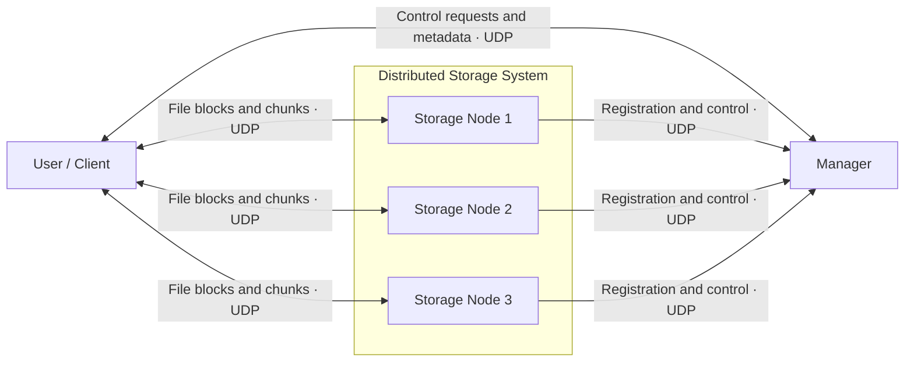
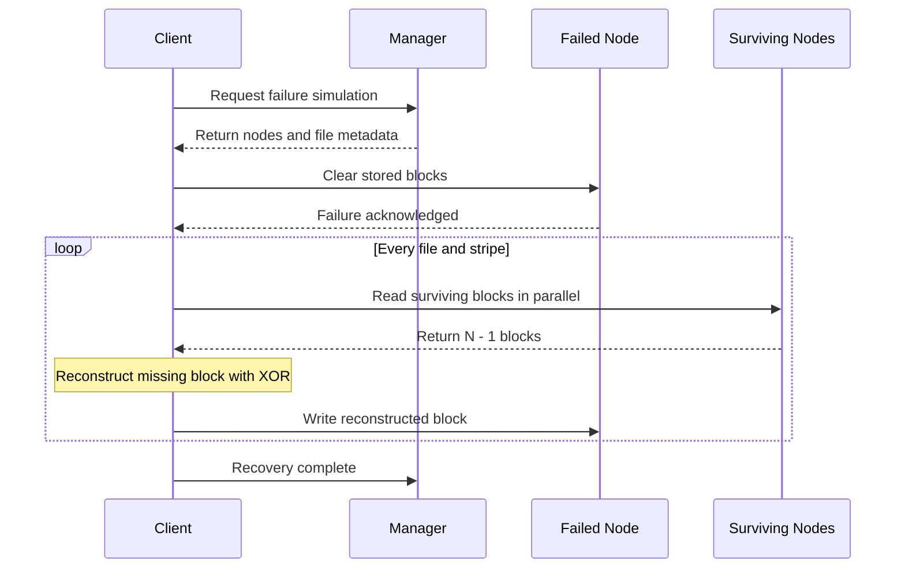

# Distributed Parity Storage over UDP

> A distributed storage prototype that stripes files across networked nodes and reconstructs missing data after a simulated node failure.

**Python · UDP Sockets · Distributed Systems · XOR Parity · Fault Recovery**

## Overview

This project implements a distributed, RAID-style storage system as three independent Python applications: a manager, storage nodes, and user clients. The applications communicate over UDP and can run on separate machines connected to the same network.

Clients divide files into stripes and distribute each stripe across multiple storage nodes. Every stripe includes rotating XOR parity, allowing the client to reconstruct the contents of one failed node from the blocks that remain. The system was developed and demonstrated across multiple virtual machines as an individual project for Arizona State University's CSE 434: Computer Networks.

## Demo

The full demonstration shows the applications running across networked hosts, storing and retrieving files, simulating a storage-node failure, rebuilding the missing blocks, and reading the recovered data.

<p>
  <a href="https://youtu.be/JjhMlfKEXKo">
    
  </a>
</p>

**[Watch the full project demonstration](https://youtu.be/JjhMlfKEXKo)**

- [System setup and application startup](https://youtu.be/JjhMlfKEXKo?t=8)
- [Storage-node failure and reconstruction](https://youtu.be/JjhMlfKEXKo?t=560)
- [Read after recovery](https://youtu.be/JjhMlfKEXKo?t=645)

An earlier [milestone demonstration](https://youtu.be/zTyOlmfR__s) shows registration and storage-system configuration across two hosts.

## How It Works



**Manager**  
Registers users and storage nodes, assigns nodes to named storage systems, tracks file metadata, and coordinates copy, read, recovery, and decommission operations. File contents do not pass through the manager.

**Storage nodes**  
Receive file blocks directly from clients and hold them in memory. Each node exposes separate UDP ports for manager control traffic and client data traffic.

**Client**  
Provides the interactive interface and performs the data-plane work: file striping, parity generation, parallel block transfer, retrieval, integrity checking, and failure recovery.

## Fault-Tolerant Storage

For a storage system with `N` nodes, each stripe contains `N - 1` data blocks and one XOR parity block. The parity position rotates between nodes so that no single node always holds parity.

```text
File → data blocks → striped data + rotating parity → storage nodes
                                                        ↓
                                              one node is cleared
                                                        ↓
                         surviving blocks → XOR reconstruction → restored node
```

When a failure is requested, the client selects one node and sends a command that clears its stored blocks. For every affected stripe, the client reads the other `N - 1` blocks, reconstructs the missing data or parity block with XOR, and writes it back to the cleared node.



The implemented recovery model supports one simulated failed storage node at a time.

## Networking Design

The applications exchange structured JSON messages using Python UDP sockets. The custom application-layer protocol identifies each message by:

- an action such as `copy-file`, `read-block`, or `recovery-complete`;
- a request or response type and success/failure status;
- an operation-specific data payload; and
- a UUID that correlates responses with waiting requests.

Manager communication and direct client-to-node transfers use separate sockets. Listener threads keep both channels responsive, while per-stripe worker threads transfer blocks to or from multiple nodes in parallel. Control requests use timeouts and structured error responses; normal reads recalculate parity and retry a stripe when its integrity check fails.

## Design Highlights

- **Rotating XOR parity:** distributes data and redundancy across all nodes.
- **Single-node reconstruction:** restores both missing data blocks and missing parity blocks.
- **Custom UDP protocol:** coordinates independently running applications with JSON messages and request IDs.
- **Control/data separation:** the manager handles metadata while clients transfer file contents directly to storage nodes.
- **Distributed testing:** manager, storage nodes, and clients were demonstrated as separate applications on networked virtual machines.

## Project Structure

```text
.
├── manager.py                 # Coordinator and metadata service
├── disk.py                    # In-memory storage-node application
├── user.py                    # Interactive client and recovery logic
├── utils.py                   # Protocol, parity, chunking, and CLI helpers
├── scripts/
│   ├── start-disks.sh         # Launch multiple nodes with tmux
│   ├── start-all.sh           # Original local development launcher
│   └── kill-all.sh            # Stop processes using the project port range
├── files-copy/                # Sample input files
├── docs/
│   ├── design-report.pdf
│   └── project-specification.pdf
└── old_files/                 # Earlier development implementation
```

The primary implementation is in [`manager.py`](manager.py), [`disk.py`](disk.py), [`user.py`](user.py), and [`utils.py`](utils.py). Files under `old_files/` are retained only as development history.

## Running the System

### Requirements

- Python 3.10 or newer
- No third-party Python packages
- `diff` for the client's final file comparison
- `tmux` only when using the disk launcher script

All processes must be able to exchange UDP traffic. Each process uses a unique pair of ports in the range `31500–31999`.

### Local example

Start the manager:

```bash
python3 manager.py
```

In another terminal, start three storage nodes:

```bash
./scripts/start-disks.sh 31501 alpha bravo charlie
```

Then start a client:

```bash
python3 user.py -n user1 -m 31507 -c 31508
```

Use the client's numbered menu to configure a storage system, copy a file from `files-copy/`, read it back, list stored files, or simulate a node failure.

### Multiple machines

Bind each application to its machine's LAN address and point nodes and clients to the manager:

```bash
python3 manager.py -i <manager-ip> -p 31500

python3 disk.py -n alpha -i <disk-ip> -m 31501 -c 31502 \
  -M <manager-ip> -P 31500

python3 user.py -n user1 -i <client-ip> -m 31507 -c 31508 \
  -M <manager-ip> -P 31500
```

Start the manager first, followed by the storage nodes and clients.

## Documentation

### [Design Report](docs/design-report.pdf)

The full report contains the protocol and message formats, time-space diagrams, design decisions, error handling, architecture details, testing evidence, and demonstration links.

### [Original Project Specification](docs/project-specification.pdf)

The original CSE 434 assignment description defines the required applications, distributed-parity model, commands, and demonstration scenarios. It is included for course context and is not implementation documentation.

## Scope

This project is an educational distributed-systems prototype rather than a production filesystem. Storage nodes keep blocks in memory, failures are explicitly simulated, and UDP file chunks do not have individual retransmission guarantees.

## Course Context

**Arizona State University**  
**CSE 434: Computer Networks · Fall 2025**  
Individual course project by Hunter Flechsig.
